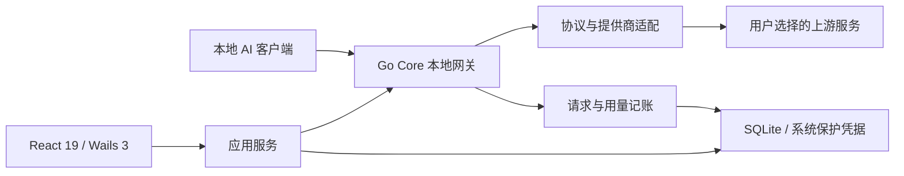

# OmniProxy

<div align="center">

**本地优先的 AI API 网关、账号调度器与额度观测控制台**

把 Codex、Claude Code、Claude Desktop、OpenCode 等 AI 开发工具接入本机网关，
在一个桌面应用中管理账号、模型路由、额度、请求用量和客户端配置。

[English](README_EN.md) · [下载安装](https://github.com/mibgb65-cloud/OmniProxy/releases) · [项目文档](docs/README.md) · [社区致谢](#社区致谢)


</div>

> 本 README 描述 **OmniProxy v2**：`main` 承载 v2 开发与发布源码，`master` 保留 v1 历史实现。
> 这是同一项目的版本演进；旧版功能不会因为同名就被视为已迁入 v2。
> 源码可能领先公开安装包，已安装版本的能力请以对应 [Release](https://github.com/mibgb65-cloud/OmniProxy/releases) 说明为准。

## 为什么需要 OmniProxy

账号、Base URL、模型与额度散落在不同客户端里，切换一次服务商往往需要重复修改多处配置。
OmniProxy 将这些状态收拢到本机，提供统一、可观察、可恢复的管理入口：

- **减少重复配置**：预览并确认客户端配置，选择接入模型和默认模型，必要时恢复原配置。
- **管理多账号**：按模型路由和账号范围选择目标，在明确拒绝时有限换号，并查看每次尝试。
- **看清实际用量**：关联请求、账号、Token、耗时与错误，不把“未报告”伪装成零。
- **保留本地控制**：配置、凭据与请求历史在本机管理，实际推理仍发送给用户选择的上游服务商。

OmniProxy 不是云端中转服务，不提供或出售上游额度；使用者需自行具备有效账号和服务权限。

## 核心能力

| 能力               | 说明                                                                                   |
| ------------------ | -------------------------------------------------------------------------------------- |
| 提供商与账号       | 内置多家提供商预设及自定义 OpenAI 兼容端点，统一管理 API Key 与已接入的订阅账号。      |
| 模型目录与路由     | 按账号同步实际模型目录，配置模型别名和固定账号，保留不同提供商的能力边界。             |
| 账号调度与故障切换 | 同通道内按规则选择账号，对明确拒绝进行冷却和额度阻断；最多三次尝试，固定账号不换号。   |
| 本地客户端接入     | 预览并确认客户端配置，管理接入模型和默认模型，提供受保护的配置备份与恢复。             |
| 请求与用量         | 查看请求结果、账号尝试、输入／输出／缓存 Token、耗时和结构化日志；未知用量不伪造成零。 |
| 额度与余额         | 按实际支持情况展示订阅额度窗口、官方余额或本机用量；本地估算不冒充官方账单。           |
| 提供商出站代理     | 支持 HTTP／SOCKS5、本机代理探测及按提供商分流，不修改系统代理或接管代理软件。          |
| 桌面体验与更新     | 系统托盘、主题与中英文界面、数据目录管理，以及稳定版／Beta 渠道的版本检查与确认更新。  |

网关提供 Chat Completions、Responses、Anthropic Messages 等接口；Codex 入口支持
HTTP／SSE 透明转发和 Responses WebSocket。**不同提供商、账号与模型支持的协议并不相同**，
具体范围见[网关说明](docs/product/GATEWAY.md)和[本地客户端接入](docs/product/LOCAL_AGENTS.md)。

## 架构

v2 使用 **Go Core + Wails 3 桌面壳 + React 19 前端**，Core 不依赖 Wails 或 React。
桌面 UI 通过类型化 Wails 绑定调用应用服务，不通过 HTTP Control API 绕行。



模块边界与技术基线见[架构概览](docs/architecture/OVERVIEW.md)和[技术栈](docs/architecture/TECH_STACK.md)。

## 提供商与能力范围

下表是接入概览，不表示每个模型、地区、套餐都支持全部协议或多模态能力。
模型权限和可用额度以所选账号及上游实际响应为准。

| 提供商／通道             | 当前范围与说明                                                                                                                    |
| ------------------------ | --------------------------------------------------------------------------------------------------------------------------------- |
| ChatGPT／Codex 订阅      | 浏览器／设备码授权、账号模型与额度；Responses 转发及 Codex 透明入口，其他协议受转换能力约束。[说明](docs/product/SUBSCRIPTION.md) |
| Google／Antigravity 订阅 | 浏览器授权、实际模型目录与额度；文本／工具 Chat，Responses／Messages 转换。[说明](docs/product/GOOGLE_SUBSCRIPTION.md)            |
| DeepSeek API             | Chat Completions，以及 Responses／Messages 文本与工具转换。[说明](docs/product/GATEWAY.md)                                        |
| River API                | 原生 Chat／Responses；Messages 经 Chat 转换，图片和流式限制见[说明](docs/product/RIVER.md)。                                      |
| Atria API                | 原生 Chat／Responses／Messages 文本与工具接口，具体限制见[网关说明](docs/product/GATEWAY.md)。                                    |
| 小米 MiMo                | 普通 API／Token Plan，地区与计费通道按账号配置。[说明](docs/product/MIMO.md)                                                      |
| Kimi                     | 普通 API／Kimi Code 订阅 Key，保留平台及协议边界，不提供 Kimi OAuth 登录。[说明](docs/product/KIMI.md)                            |
| MiniMax                  | 国内／海外普通 API 与订阅 Key，按真实 Key 类型及地区接入。[说明](docs/product/MINIMAX.md)                                         |
| StepFun                  | 普通 API／Step Plan，按账号地区与计费方式选择端点。[说明](docs/product/STEPFUN.md)                                                |
| Google API Key           | 官方 OpenAI 兼容 Chat；不等同于 Antigravity 订阅的协议范围。[说明](docs/product/GATEWAY.md)                                       |
| Oxion AI                 | Chat Completions 与按账号发现模型，无内置模型预设。[说明](docs/product/OXIONAI.md)                                                |

OpenAI 普通 API Key、Anthropic、智谱及自定义兼容端点等配置预设的存在，
**不代表对应原生推理适配已完成**。不能直接套用 v1 的支持矩阵；请以应用检查和当前产品文档为准。

## 客户端一键配置

| 客户端                              | v2 托管范围                                                                         |
| ----------------------------------- | ----------------------------------------------------------------------------------- |
| Codex CLI／Desktop                  | 模型目录、默认模型、订阅登录及配置备份／恢复；透明入口与 WebSocket 开关见网关文档。 |
| Claude Code／Claude Desktop         | 模型接入与配置恢复；Desktop 使用独立 3P 条目，首次需手动选择并重新加载。            |
| OpenCode CLI／Desktop               | 共用引擎配置、受管模型目录与默认模型。                                              |
| Kilo Code／Qwen Code／MiMo Code     | 按实际引擎与宿主路径预览配置，不保证所有桌面宿主读取同一全局文件。                  |
| Kimi Code／Pi／Factory Droid／Goose | 独立接入配置、模型选择和备份恢复；关联文件按客户端规则共同校验。                    |
| DeepSeek Harness Desktop／Web       | 分别管理本地 profile，提供模型目录与受控配置恢复。                                  |

上游支持 Gemini 模型不等于 Gemini CLI 一键配置已经接入；不在当前托管白名单中的 v1 客户端不能直接视为兼容。
接入步骤、版本限制和配置保护见[本地 Agent 接入](docs/product/LOCAL_AGENTS.md)。

## 本地入口

以下为默认生产端口下的**请求示例**，不是所有客户端的 Base URL 写法。
客户端基址、模型和鉴权应使用应用中实际生成的预览；入口仍受本机接入配置与鉴权规则约束。

| 用途                 | 请求示例                                                                               |
| -------------------- | -------------------------------------------------------------------------------------- |
| Codex Responses      | `POST http://127.0.0.1:3000/codex/v1/responses`；同一路径可按设置使用 WebSocket。      |
| Claude Messages      | `POST http://127.0.0.1:3000/claude/v1/messages`                                        |
| OpenCode Chat        | `POST http://127.0.0.1:3000/opencode/v1/chat/completions`                              |
| Pi／Goose Chat       | `POST http://127.0.0.1:3000/pi/v1/chat/completions` 或 `/goose/v1/chat/completions`    |
| 通用协议入口         | `POST /v1/chat/completions`、`POST /v1/responses`、`POST /v1/messages`，位于代理端口。 |
| Control API 健康检查 | `GET http://127.0.0.1:3890/healthz`                                                    |

开发环境默认代理／Control 端口为 `3001`／`3891`，生产环境为 `3000`／`3890`，以实际运行地址为准。
**当前 v2 HTTP Control API 仅提供健康检查**，不提供 v1 的 `/api/tokens`、账单或客户端管理接口。

## 下载安装

目前维护与发布的平台为 **Windows 10／11 x64**，需要 WebView2 Runtime。
Linux、macOS 及其他架构暂未作为已维护的发行目标。

1. 打开 [GitHub Releases](https://github.com/mibgb65-cloud/OmniProxy/releases)，选择需要的正式版或 Beta。
2. 下载对应的 Windows 安装包，核对该 Release 提供的 SHA256。
3. 运行安装向导，确认程序目录及数据存储位置，完成后启动 OmniProxy。

安装包使用**项目自签证书，而非公开受信任 CA 证书**，Windows 仍可能提示 SmartScreen
或未知发布者。请核对下载来源与校验值；安装器不会修改用户的证书信任库。
详情见[代码签名政策](CODE_SIGNING_POLICY.md)。

## 快速开始

1. **添加账号**：在提供商／账号页面添加自己的 API Key，或使用已支持的订阅授权入口。
2. **同步模型**：在路由页面按账号同步模型目录，按需配置模型别名或固定账号。
3. **启动网关**：在网关页面检查配置并启动本机服务。生产环境默认代理端口为 `3000`，以页面实际显示的地址为准。
4. **配置客户端**：进入「客户端接入」，选择已安装的客户端，预览并确认要写入的模型与配置。
5. **验证调用**：重新加载或重启对应客户端，发起请求，在请求页核对实际账号、结果与用量。

部分桌面客户端需要手动选择新建的配置条目；配置写入成功不等于客户端已经加载或上游请求成功。
具体步骤和版本限制见[本地客户端接入](docs/product/LOCAL_AGENTS.md)。

### 使用边界

- 需要使用者自行具备有效账号、API Key 或订阅权限；OmniProxy 不提供或出售上游额度。
- 显式固定的账号不会自动切换；故障切换不静默换模型，也不把订阅消费改为按量计费。
- 额度、余额和协议能力以所选账号及上游实际返回为准，不保证所有预设均支持全部功能。
- 账号配置、请求历史与本机统计在本地保存；实际推理请求仍会发送给所选上游服务商。

从 v1 升级前请先备份数据，使用受支持的导入入口；订阅登录、旧目录和接口不保证直接兼容。
详见[升级边界](docs/product/UPGRADE.md)。

## 发布与更新

| 通道     | 适用范围                                                        |
| -------- | --------------------------------------------------------------- |
| Stable   | GitHub 正式 Release；日常使用以对应版本的公开安装包与说明为准。 |
| Beta     | GitHub Pre-release；用于新功能和回归验证，不默认替代稳定版。    |
| 本地开发 | `task dev` 或本地验证构建，不等同于公开 Release 或已安装版本。  |

应用支持渠道选择、版本检查、下载与 SHA256 校验；自动下载默认关闭，安装与重启仍需确认。
详见[安装与更新](docs/product/UPDATE.md)和[发布说明](docs/releases/)。

## 开发与验证

### 开发环境

- Go 1.26+，最低版本见 [`go.mod`](go.mod)。
- Node.js 22.x，见 [`.nvmrc`](.nvmrc) 和 [`frontend/package.json`](frontend/package.json)。
- pnpm，使用仓库提交的 `pnpm-lock.yaml`；不要混用其他包管理器生成锁文件。
- [Task](https://taskfile.dev) 与 Wails 3 CLI：

```bash
go install github.com/go-task/task/v3/cmd/task@latest
go install github.com/wailsapp/wails/v3/cmd/wails3@v3.0.0-beta.30
```

桌面开发同样需要 Windows 和 WebView2；生成 NSIS 安装包还需安装 NSIS。

### 初始化与启动

首次初始化会安装前端依赖、下载 Go 模块并安装静态检查工具：

```bash
task setup
task dev
```

`task dev` 提供 Go 重建与 Vite 热更新。开发环境默认代理端口为 `3001`，
与生产环境的数据目录和默认端口隔离。

如需覆盖运行 profile、日志级别或端口，可参考 [`.env.example`](.env.example) 创建本地 `.env`；
不要提交 `.env`、真实凭据或包含敏感内容的日志。

### 测试与打包

```bash
task test       # Go 测试 + Vitest 前端测试
task verify     # 格式检查 → lint → 类型检查 → 测试 → 构建
task build      # Windows production 程序 → bin/omniproxy.exe
task package    # 默认 Windows amd64 NSIS 安装包 → bin/OmniProxy-amd64-installer.exe
```

本地验证构建不等于公开 Release，也不会自动替换已安装的生产程序。
环境配置、运行 profile 和产物说明见[构建文档](docs/development/BUILD.md)，
正式发布流程见[发布指南](docs/development/RELEASE.md)。

## 项目结构

```text
main.go                  Wails 3 启动入口
internal/core/           与桌面无关的网关、协议和领域能力
internal/application/    账号、路由、客户端配置与用量应用服务
internal/provider/       已实现的上游适配器
internal/infrastructure/ SQLite、日志、系统保护凭据等基础设施
internal/transport/      Wails 绑定与本地 HTTP 适配层
frontend/                React 19 + TypeScript + Vite
migrations/              追加式数据库迁移
docs/                    产品、架构、开发规范、发布与任务记录
```

## 项目文档

完整索引见 [`docs/README.md`](docs/README.md)。

| 文档                                      | 内容                         |
| ----------------------------------------- | ---------------------------- |
| [产品定义](docs/product/PRD.md)           | 项目目标、能力与非目标       |
| [架构概览](docs/architecture/OVERVIEW.md) | 组件与模块边界               |
| [账号故障切换](docs/product/FAILOVER.md)  | 换号范围、拒绝分类与消费边界 |
| [请求与用量](docs/product/ACTIVITY.md)    | 本机统计、留存与展示口径     |
| [网络代理](docs/product/NETWORK_PROXY.md) | 出站代理与提供商分流         |
| [安装与更新](docs/product/UPDATE.md)      | 检查、下载、校验与确认安装   |
| [开发规范](docs/development/)             | 编码、Git、测试、构建与发布  |
| [当前状态](docs/plans/CURRENT.md)         | 源码进展及待验收事项         |

## 安全与隐私

- 默认只监听本机 loopback，不作为公网或局域网共享代理部署。
- Windows 凭据通过 DPAPI 及现有系统凭据机制保护，数据库保存凭据引用，不保存明文 API Key。
- 日志经过统一脱敏；反馈问题时仍请自行检查并移除账号身份、接入 Key 和请求中的敏感内容。
- 使用过程中请遵守上游服务商的服务条款，不使用未经授权的账号或凭据。

详细政策见[隐私政策](PRIVACY.md)、[安全政策](SECURITY.md)与[代码签名政策](CODE_SIGNING_POLICY.md)。

## 贡献与反馈

欢迎提交 [Issue](https://github.com/mibgb65-cloud/OmniProxy/issues) 或 [Pull Request](https://github.com/mibgb65-cloud/OmniProxy/pulls)。
问题报告请包含系统及应用版本、安装包或源码运行方式、客户端版本、所用提供商与模型、预期／实际行为及最小复现步骤。
附日志前请移除凭据、账号身份、私有地址和请求内容。

提交 PR 前运行 `task verify`。AI 编程助手须先阅读 [`AGENTS.md`](AGENTS.md)，
创建 [Task Record](docs/tasks/README.md) 并遵循[开发规范](docs/development/)。
不确定的能力请标为待确认，不用旧版描述替代实现验证。

## 社区致谢

特别感谢 **[LINUX DO 社区](https://linux.do/)**。

感谢社区在技术交流、知识分享与开源协作中营造的开放氛围，也感谢每一位愿意分享经验、
提出问题和参与讨论的社区成员。希望 OmniProxy 也能成为社区交流与实践中的一份小小回馈。

感谢所有 OmniProxy 贡献者，以及 Go、Wails、React 和本项目依赖的开源工具与库。
社区致谢不代表 LINUX DO 对本项目的官方背书。
如果项目对你有帮助，欢迎点一个 Star；可复现的问题反馈与回归用例同样重要。

## 许可证

OmniProxy 使用 [MIT License](LICENSE)，保留现有版权与许可声明。第三方依赖受各自许可证约束。
