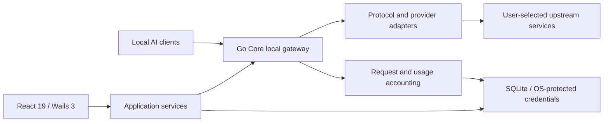

# OmniProxy

<div align="center">

**A local-first AI API gateway, account scheduler, and quota observability console**

Connect Codex, Claude Code, Claude Desktop, OpenCode, and other supported AI development tools to a local gateway.
Manage accounts, model routes, quotas, request usage, and client configuration in one desktop application.

[中文](README.md) · [Downloads](https://github.com/mibgb65-cloud/OmniProxy/releases) · [Documentation](docs/README.md) · [Community acknowledgements](#community-acknowledgements)


</div>

> This README describes **OmniProxy v2**. `main` contains v2 development and release source; `master` retains the v1 implementation.
> These are versions of the same project, not a guarantee that every v1 feature has been ported.
> Source can be ahead of published installers. Check the relevant [Release](https://github.com/mibgb65-cloud/OmniProxy/releases) notes for your installed version.

## Why OmniProxy?

Accounts, base URLs, models, and quota information are scattered across client configuration files.
OmniProxy brings that state together locally:

- **Less repeated configuration:** preview and confirm changes, select models and defaults, and restore previous configuration.
- **Multi-account control:** route to eligible accounts, switch on explicit rejections within bounded rules, and inspect each attempt.
- **Observable usage:** correlate requests, accounts, tokens, latency, and errors without treating unreported usage as zero.
- **Local ownership:** manage configuration, credentials, and history locally; actual inference still goes to your selected upstream provider.

OmniProxy is not a hosted relay and does not supply or sell provider quota. You need your own valid accounts and service access.

## Core capabilities

| Capability            | Current v2 behavior                                                                                                                                       |
| --------------------- | --------------------------------------------------------------------------------------------------------------------------------------------------------- |
| Local gateway         | Provider-dependent Chat Completions, Responses, and Messages; transparent Codex HTTP/SSE forwarding and Responses WebSocket.                              |
| Models and routing    | Discover models per account, configure exact aliases and fixed accounts, and distinguish presets from actual permissions.                                 |
| Accounts and failover | Selection within the same channel, explicit-rejection handling, cooldowns, and quota blocking; up to three attempts, with no rotation for fixed accounts. |
| Quota and balance     | Supported subscription windows, official balances, or local usage; local cost estimates are not official bills.                                           |
| Requests and logs     | Logical requests and account attempts, input/output/cache tokens, first-token and total latency, and correlated structured logs.                          |
| Client configuration  | Preview, confirmation, model selection, protected backup, and restore; a successful write does not prove the client reloaded or inference succeeded.      |
| Outbound proxies      | HTTP/SOCKS5, discovery, and per-provider routing; no system proxy changes or management of proxy applications and nodes.                                  |
| Desktop and updates   | Tray, themes, Chinese/English UI, data-directory management, and stable/beta checks, verified downloads, and confirmed installation.                      |

Failover does not silently switch providers, billing channels, or models. See [failover boundaries](docs/product/FAILOVER.md).

## Architecture

v2 uses **Go Core + Wails 3 desktop shell + React 19**. Core does not depend on Wails or React.
The desktop UI calls application services through typed Wails bindings, not through the HTTP Control API.



See the [architecture overview](docs/architecture/OVERVIEW.md) and [technology baseline](docs/architecture/TECH_STACK.md).
Detailed product documentation is currently primarily in Chinese.

## Providers and capability boundaries

This is an integration overview, not a promise that every model, region, plan, or modality supports every protocol.
Permissions and available quota depend on the selected account and the provider's actual response.

| Provider/channel                | Current scope                                                                                                                                                                                    |
| ------------------------------- | ------------------------------------------------------------------------------------------------------------------------------------------------------------------------------------------------ |
| ChatGPT/Codex subscription      | Browser/device authorization, account models and quota, Responses forwarding, and transparent Codex entry; other protocols depend on conversion support. [Details](docs/product/SUBSCRIPTION.md) |
| Google/Antigravity subscription | Browser authorization, discovered models and quota, text/tool Chat, and Responses/Messages conversion. [Details](docs/product/GOOGLE_SUBSCRIPTION.md)                                            |
| DeepSeek API                    | Chat Completions plus text/tool conversion for Responses and Messages. [Details](docs/product/GATEWAY.md)                                                                                        |
| River API                       | Native Chat/Responses; Messages through Chat conversion, with documented image and streaming limits. [Details](docs/product/RIVER.md)                                                            |
| Atria API                       | Native text/tool Chat, Responses, and Messages, subject to documented limits. [Details](docs/product/GATEWAY.md)                                                                                 |
| Xiaomi MiMo                     | Regular API/Token Plan, with account-specific region and billing channel. [Details](docs/product/MIMO.md)                                                                                        |
| Kimi                            | Regular API/Kimi Code subscription keys, with platform and protocol limits; no Kimi OAuth login. [Details](docs/product/KIMI.md)                                                                 |
| MiniMax                         | Domestic/international API and subscription keys, using the configured key type and region. [Details](docs/product/MINIMAX.md)                                                                   |
| StepFun                         | Regular API/Step Plan, with region- and billing-specific endpoints. [Details](docs/product/STEPFUN.md)                                                                                           |
| Google API key                  | The official OpenAI-compatible Chat endpoint, not the Antigravity subscription protocol scope. [Details](docs/product/GATEWAY.md)                                                                |
| Oxion AI                        | Chat Completions and per-account model discovery, with no built-in model presets. [Details](docs/product/OXIONAI.md)                                                                             |

Configuration presets for ordinary OpenAI API keys, Anthropic, Zhipu, and custom compatible endpoints
**do not mean their native inference adapters are complete**. Do not apply the v1 support matrix to v2 without checking implementation.

## Managed client configuration

| Client                           | v2 managed scope                                                                                                            |
| -------------------------------- | --------------------------------------------------------------------------------------------------------------------------- |
| Codex CLI/Desktop                | Model catalog, default model, subscription login, configuration backup/restore, transparent entry, and WebSocket setting.   |
| Claude Code/Claude Desktop       | Model configuration and restore; Desktop uses a separate 3P entry that must be selected and reloaded.                       |
| OpenCode CLI/Desktop             | Shared engine configuration, managed models, and default model.                                                             |
| Kilo Code/Qwen Code/MiMo Code    | Preview actual engine and host paths; desktop hosts may not read the same global file.                                      |
| Kimi Code/Pi/Factory Droid/Goose | Separate integration configuration, model selection, and protected backup/restore, with client-specific linked-file checks. |
| DeepSeek Harness Desktop/Web     | Separate local profiles, model catalogs, and controlled restore.                                                            |

Supporting Gemini models upstream does not mean Gemini CLI configuration management is implemented.
Clients outside the current managed allowlist are not automatically compatible because v1 supported them.
See [local client integration](docs/product/LOCAL_AGENTS.md) for steps and version boundaries.

## Local endpoints

These are **request examples** for default production ports, not interchangeable client base URLs.
Use the application's generated configuration preview for the actual base URL, models, and authentication.
Local integration configuration and authorization rules still apply.

| Purpose                  | Example request                                                                                 |
| ------------------------ | ----------------------------------------------------------------------------------------------- |
| Codex Responses          | `POST http://127.0.0.1:3000/codex/v1/responses`; the same path supports WebSocket when enabled. |
| Claude Messages          | `POST http://127.0.0.1:3000/claude/v1/messages`                                                 |
| OpenCode Chat            | `POST http://127.0.0.1:3000/opencode/v1/chat/completions`                                       |
| Pi/Goose Chat            | `POST http://127.0.0.1:3000/pi/v1/chat/completions` or `/goose/v1/chat/completions`             |
| General protocol entry   | `POST /v1/chat/completions`, `POST /v1/responses`, and `POST /v1/messages` on the proxy port.   |
| Control API health check | `GET http://127.0.0.1:3890/healthz`                                                             |

Default development proxy/control ports are `3001`/`3891`; production defaults are `3000`/`3890`.
Use the actual runtime address. **The v2 HTTP Control API currently exposes only the health check**, not v1's `/api/tokens`, billing, or client-management APIs.

## Getting started

### Install and use

The maintained v2 release target is **Windows 10/11 x64**, with WebView2 Runtime.
macOS, Linux, and other architectures are not maintained v2 release targets.

1. Download the appropriate installer from [GitHub Releases](https://github.com/mibgb65-cloud/OmniProxy/releases) and verify its SHA256.
2. Confirm application and data locations in the installer, then add your API key or use a supported subscription authorization flow.
3. Sync account models and optionally configure aliases, fixed accounts, or a same-channel account pool.
4. Start the gateway, then preview and confirm models and configuration under client integration.
5. Restart/reload the client, send a request, and check the actual account, result, and usage.

Back up data before migrating from v1 and use supported import flows. Subscription login, old directories, and APIs are not assumed compatible.
See [upgrade boundaries](docs/product/UPGRADE.md).

### Usage boundaries

- Use your own valid account, API key, or subscription. OmniProxy does not provide upstream quota.
- Fixed accounts do not rotate. Failover does not silently change models or turn subscription requests into pay-as-you-go consumption.
- Provider and account capabilities vary; configuration presets are not evidence of a fully implemented inference path.
- Configuration and local statistics stay on your machine, but inference requests still access the selected upstream provider.

## Releases and updates

| Channel           | Purpose                                                                                       |
| ----------------- | --------------------------------------------------------------------------------------------- |
| Stable            | A regular GitHub Release; use its published installer and release notes.                      |
| Beta              | A GitHub Pre-release for feature and regression testing, not an automatic stable replacement. |
| Local development | `task dev` or verification builds, not a public Release or an installed-version update.       |

The application supports channel selection, update checks, downloads, and SHA256 verification.
Automatic downloads are off by default; installation and restart still require confirmation.
Windows installers use a **project self-signed certificate, not a publicly trusted CA certificate**.
SmartScreen or unknown-publisher warnings may remain; installers do not modify the user's certificate trust stores.
See [updates](docs/product/UPDATE.md), [code signing](CODE_SIGNING_POLICY.md), and [release notes](docs/releases/).

## Development and verification

Use Go 1.26+, Node.js 22.x, pnpm, Task, Wails 3 CLI, and Windows/WebView2. NSIS is required for installer packaging.
Version requirements are documented in [`go.mod`](go.mod), [`.nvmrc`](.nvmrc), and [`frontend/package.json`](frontend/package.json).

```bash
go install github.com/go-task/task/v3/cmd/task@latest
go install github.com/wailsapp/wails/v3/cmd/wails3@v3.0.0-beta.30
task setup
task dev
```

```bash
task test       # Go + Vitest
task verify     # Format -> lint -> typecheck -> tests -> build
task build      # bin/omniproxy.exe
task package    # Default amd64: bin/OmniProxy-amd64-installer.exe
```

Use [`.env.example`](.env.example) for local profile, logging, and port overrides; never commit a real `.env`.
Development and production default data directories are isolated. A local build does not automatically replace an installed production application.
See the [build guide](docs/development/BUILD.md) and [release guide](docs/development/RELEASE.md).

## Project layout

```text
main.go                  Wails 3 entry point
internal/core/           Desktop-independent gateway, protocols, and domain logic
internal/application/    Accounts, routing, client configuration, and usage services
internal/provider/       Implemented upstream adapters
internal/infrastructure/ SQLite, logging, and OS-protected credential storage
internal/transport/      Wails bindings and local HTTP adapters
frontend/                React 19 + TypeScript + Vite
migrations/              Append-only database migrations
docs/                    Product, architecture, development, releases, and task records
```

## Documentation

Most detailed product documentation is currently in Chinese.

| Document                                       | Purpose                                                 |
| ---------------------------------------------- | ------------------------------------------------------- |
| [Documentation index](docs/README.md)          | Product, architecture, development, and task references |
| [Product definition](docs/product/PRD.md)      | Goals, scope, and non-goals                             |
| [Architecture](docs/architecture/OVERVIEW.md)  | Components and boundaries                               |
| [Account failover](docs/product/FAILOVER.md)   | Rejection handling, rotation, and billing boundaries    |
| [Requests and usage](docs/product/ACTIVITY.md) | Local accounting, retention, and presentation           |
| [Network proxy](docs/product/NETWORK_PROXY.md) | Outbound proxy configuration and routing                |
| [Updates](docs/product/UPDATE.md)              | Checking, downloading, verification, and installation   |
| [Development rules](docs/development/)         | Coding, Git, testing, builds, and release procedures    |
| [Current status](docs/plans/CURRENT.md)        | Source progress and outstanding validation              |

## Security and privacy

- Bind to local loopback by default; this is not a public or LAN shared proxy deployment.
- Windows credentials use DPAPI and existing system credential mechanisms; the database stores references, not plaintext API keys.
- Configuration backups and authorization files may contain real credentials. Keep them private and review logs/screenshots before sharing.
- Local usage is not an official bill. Inference accesses the selected upstream; follow its terms and never use unauthorized credentials.

See the [privacy policy](PRIVACY.md) and [security policy](SECURITY.md).

## Contributing and feedback

[Issues](https://github.com/mibgb65-cloud/OmniProxy/issues) and [pull requests](https://github.com/mibgb65-cloud/OmniProxy/pulls) are welcome.
Include OS/app versions, installer or source execution, client version, provider/model, expected and actual behavior, and a minimal reproduction.
Remove credentials, account identity, private addresses, and request content before attaching logs.

Run `task verify` before submitting a PR. AI coding agents must read [`AGENTS.md`](AGENTS.md), create a
[Task Record](docs/tasks/README.md), and follow the [development rules](docs/development/).
Mark unconfirmed capabilities as unconfirmed rather than borrowing unsupported claims from v1.

## Community acknowledgements

Special thanks to the **[LINUX DO community](https://linux.do/)** for fostering open technical discussion,
knowledge sharing, and open-source collaboration, and to the members who share experience, report issues, and join discussions.
We hope OmniProxy can contribute something useful in return.

Thank you to all OmniProxy contributors and the open-source projects behind Go, Wails, React, and our dependencies.
This acknowledgement does not imply official endorsement by LINUX DO.
If OmniProxy helps your workflow, consider a Star; reproducible reports and regression cases are equally valuable.

## License

OmniProxy is released under the [MIT License](LICENSE), retaining the existing copyright and license notices.
Third-party dependencies remain subject to their respective licenses.
